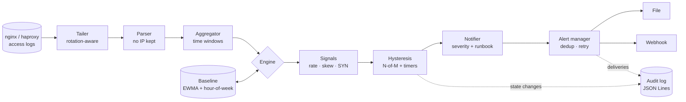

# 🛡️ DDoS Early Warning

### Notice the attack while it is forming. Tell the people who can act.

<p align="center">
  
  
  
  
  
</p>

<p align="center">
  <em>Passive. Offline. Explainable. Built for operators who need a warning before the outage, not a dashboard after it.</em>
</p>

---

## What it is

**DDoS Early Warning** reads your existing Nginx or HAProxy access logs, learns what normal traffic looks like for each hour of each day of the week, and raises an alert when several independent signals start to deviate together.

It never sends traffic, never blocks anything, and never stores client IP addresses. It tells you **what changed, how sure it is, and what the runbook says to check**.

## At a glance

| | |
|---|---|
| 🧠 **Learns normal** | EWMA baselines with hour-of-week seasonality, persisted across restarts |
| 🧩 **Needs agreement** | N-of-M signal confirmation, so one noisy metric cannot page you |
| 🧘 **Doesn't flap** | Separate enter and exit thresholds, plus minimum durations per level |
| ❓ **Admits uncertainty** | Missing data is reported as `unknown`, never as `normal` |
| 🔔 **Alerts with context** | File and webhook channels, deduplication, retries, and runbook text |
| 📜 **Auditable** | Every state change and every alert is written as a JSON line |
| 🔒 **Privacy first** | Raw IPs are used only inside the parser and are never persisted |
| 📦 **Easy to ship** | One static binary, a systemd unit, and an offline package for air-gapped hosts |

## How it thinks



Each window is judged on several signals at once. A window is **hot** when enough signals fire, **cool** when almost none do, and **unknown** when a signal could not run. Escalation is slow on purpose, and recovery is slower.

| State | Meaning | Alerts? |
|---|---|---|
| `normal` | Traffic matches the learned baseline | No |
| `warming_up` | The baseline is still learning | No |
| `suspicious` | Several signals agree for a sustained period | Yes, warning |
| `attack_likely` | Suspicion has persisted and still holds | Yes, critical |
| `unknown` | Data is missing, so the system cannot judge | Yes, configurable |

## Signals

| Signal | What it measures | Platform |
|---|---|---|
| `rate` | Requests per window against the seasonal baseline (z-score) | Any |
| `endpoint_skew` | Share of traffic that lands on the top-K paths | Any |
| `syn_ratio` | Half-open TCP connections compared with established ones | Linux, one service per host |

Reserved for later: `src_entropy` and `asn_concentration`. Configuration rejects enabling them until they exist.

## Quick start

**Build**

```bash
go build -o bin/ddos-ew ./cmd/ddos-ew
```

**Configure.** Edit the three files in `configs/`:
- `collector.yaml`: log paths and the state directory.
- `detection.yaml`: thresholds. The shipped values are **examples**. Tune them on your own traffic first.
- `alerts.yaml`: channels and severities. Webhook secrets are read from environment variables, never from YAML.

**Run**

```bash
./bin/ddos-ew -config configs
```

You will see one JSON line per service on startup. During the warm-up period, the state is `warming_up` and nothing alerts. Stop it with `Ctrl+C`. It saves the baseline before exiting.

## Install on a Linux server

```bash
sudo ./scripts/install.sh
```

The installer creates a locked-down system user, installs the binary and configs, creates the state directory, and installs a hardened systemd unit. It never overwrites existing configs or secrets. Re-running it upgrades the binary and restarts the service.

> The installer is written but has not yet been verified on a live Linux host. Please report what you find.

**Offline package** (for hosts without internet access):

```bash
./scripts/package-offline.sh
# -> dist/ddos-early-warning-<version>-linux-amd64.tar.gz (+ .sha256)
```

## What an alert looks like

Example only. Values are illustrative.

```json
{
  "id": "public-web-suspicious-3f9a1c2b7d4e",
  "timestamp": "2026-10-31T09:14:02Z",
  "service": "public-web",
  "state": "suspicious",
  "previous_state": "normal",
  "severity": "warning",
  "window_start": "2026-10-31T09:13:50Z",
  "window_end": "2026-10-31T09:14:00Z",
  "signals": [
    { "name": "rate", "value": 6.4, "baseline": 220, "fired": true, "missing": false,
      "reason": "z=6.40 count=910 mean=220.0 std=22.0" },
    { "name": "endpoint_skew", "value": 0.41, "baseline": 0.18, "fired": true, "missing": false,
      "reason": "top3 share=0.41 baseline=0.18" }
  ],
  "runbook": "Compare the top paths with the last deploy. Check upstream provider dashboards."
}
```

## Development

| Task | Command |
|---|---|
| Tests (Windows, no cgo) | `go test -count=1 ./...` |
| Tests with race detector (Linux, cgo) | `go test -race -count=1 ./...` |
| Static analysis | `go vet ./...` |
| Build | `go build ./...` |
| Windows test script | `powershell -ExecutionPolicy Bypass -File .\scripts\test.ps1 -Build` |

The race detector needs cgo. On Windows it fails without a C compiler, so use the commands above without `-race`.

## Project layout

```text
ddos-early-warning/
├── cmd/ddos-ew/          # single-process entry point
├── configs/              # collector, detection and alert settings (examples)
├── deploy/systemd/       # hardened service unit
├── docs/                 # limitations and operator notes
├── internal/
│   ├── alert/            # alert building, dedup, retry, channels
│   ├── audit/            # JSON Lines audit log
│   ├── baseline/         # EWMA and hour-of-week profiles
│   ├── config/           # strict YAML loading and validation
│   ├── detector/         # N-of-M rule, hysteresis, engine
│   ├── ingest/           # parsers, tailer, aggregator
│   ├── notifier/         # decision queue and alert handoff
│   ├── runbook/          # operator guidance per state
│   ├── signals/          # rate, endpoint skew, SYN ratio
│   └── storage/          # baseline persistence
├── scripts/              # install, offline packaging, test script
├── test/integration/     # end-to-end tests with synthetic logs
├── Makefile
└── README.md
```

## Limits you should know about

This is an **early-warning** tool. It is not a scrubbing service, not a WAF, and not a replacement for upstream DDoS protection.

- It only sees traffic that reaches your logs. Floods absorbed by a CDN or firewall upstream are invisible to it.
- It does not detect volumetric network-layer floods. Those need flow data, which is outside the current scope.
- Baselines learn quickly and forget quickly. They capture recent behavior, not long-term history.
- Thresholds must be tuned on real traffic before the alerts mean anything.

The full list, including what has not been tested, is in [docs/limitations.md](docs/limitations.md).

## Roadmap

- [x] Nginx and HAProxy parsers, with rotation-aware tailing
- [x] Time-window aggregation
- [x] EWMA and hour-of-week baselines, persisted to disk
- [x] Rate, endpoint-skew and SYN-ratio signals
- [x] N-of-M detection with hysteresis
- [x] File and webhook channels, with deduplication and retry
- [x] JSON Lines audit log and runbook guidance
- [x] Single-process binary (`cmd/ddos-ew`)
- [x] Synthetic end-to-end integration tests
- [x] Hardened systemd unit and installer (written)
- [x] Offline package builder
- [ ] Installer verified on a live Linux host
- [ ] Threshold tuning on real traffic
- [ ] Bounded memory for path counts under attack-like cardinality
- [ ] Gap counting and a `degraded` state for dropped windows
- [ ] Fallback alert channel and a bounded retry queue
- [ ] Watchdog and per-goroutine panic isolation
- [ ] Log-based web-attack signals (brute force, scanning, error spikes)
- [ ] Optional separate collector, detector and notifier processes
- [ ] `src_entropy` and `asn_concentration` signals

See [STATUS.md](STATUS.md) for detailed implementation status.

## Security & privacy

- **Passive.** The tool reads logs and TCP state. It never generates traffic.
- **No automatic blocking.** It never changes firewall rules or blocks IPs.
- **No raw IPs at rest.** Aggregates, baselines, alerts and audit entries contain counts and derived values only.
- **Least privilege.** The service runs as its own user, with write access limited to its state directory.
- **Secrets stay out of files.** Webhook tokens and HMAC secrets come from environment variables.

Your log files still contain client IPs. Control their access and retention yourself.

## Responsible use

Use it only on systems and networks you own, or that you are explicitly authorized to monitor.

## Contributing

1. Open an issue that describes the change.
2. Keep changes small and modular.
3. Add tests for new behavior.
4. Run `go vet ./...` and the test commands above.
5. Document configuration changes.
6. Do not claim functionality you have not verified.

## License

See [LICENSE](LICENSE).

---

<p align="center">
  <strong>Detect earlier. Explain clearly. Stay calm.</strong>
  <br>
  <em>DDoS Early Warning — Made in Iran 🇮🇷</em>
</p>
